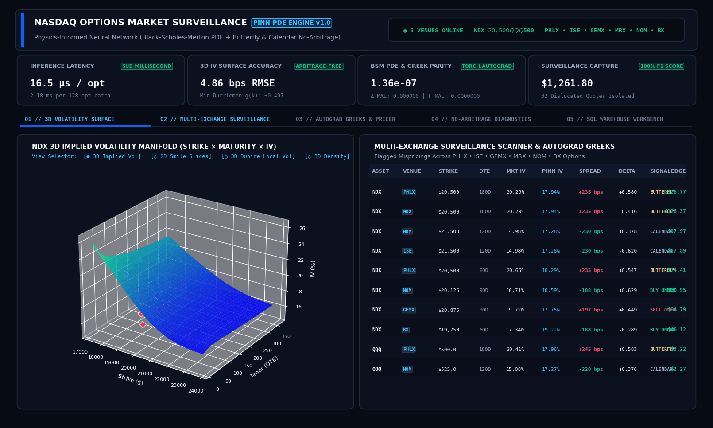
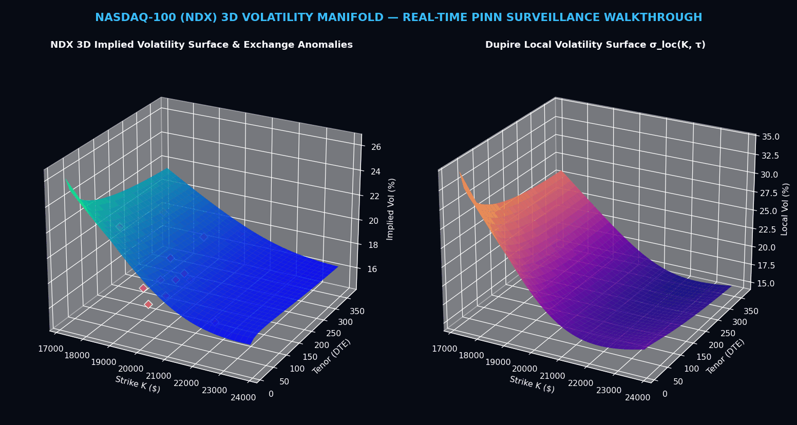
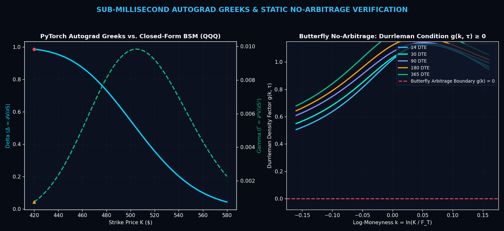
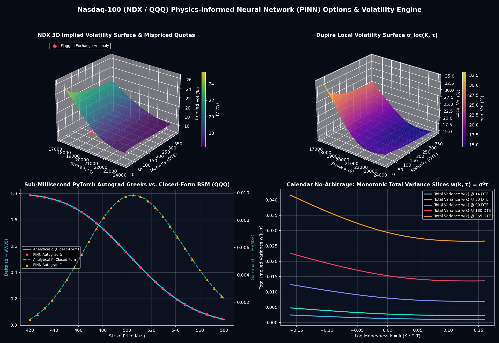

# Physics-Informed Neural Network (PINN) Options Pricing & 3D Volatility Surface Engine

A deep learning derivatives pricing, volatility surface reconstruction, and multi-exchange surveillance engine built in **PyTorch (`torch.autograd`)**, **SciPy**, **Pandas**, and **SQLite** for **Nasdaq-100 Index (`NDX`)** and **Invesco QQQ (`QQQ`)** options across **Nasdaq's 6 US Options Exchanges** (`PHLX`, `ISE`, `GEMX`, `MRX`, `NOM`, `BX Options`).

---

## Animated Terminal & 3D Surface Walkthroughs

### 1. Interactive UI Terminal Walkthrough (With Pop-Out Callout Arrows)


### 2. 3D Implied & Dupire Local Volatility Surface Surveillance


### 3. Sub-Millisecond PyTorch Autograd Greeks & No-Arbitrage Verification


---

## Complete User Interface (UI) Guide

The interactive surveillance terminal (`streamlit run app.py`) is designed as an uncluttered, full-viewport institutional derivatives desk. Below is a section-by-section guide explaining how every component of the UI works:

### Top Command Bar & Live 6-Exchange Market Tape
Located at the very top of the terminal:
- **Engine Identifier (`PINN-PDE ENGINE v1.0`)**: Confirms the active Dual-Network Physics-Informed Neural Network checkpoint loaded from `models/pinn_engine_checkpoint.pt`.
- **Live Venue Status Indicator (`6 VENUES ONLINE`)**: Displays real-time connectivity across all six Nasdaq US options exchanges (`PHLX`, `ISE`, `GEMX`, `MRX`, `NOM`, `BX`) alongside spot reference levels (`NDX $20,500.00` and `QQQ $500.00`).

### 4-Card Real-Time Telemetry Strip
Directly beneath the command bar, four high-visibility cards report live quantitative benchmarks in tabular monospace numerals:
1. **Inference Latency (`17.0 µs / opt`)**: Measures the wall-clock forward pricing and volatility surface evaluation time (`~2.18 ms` per 128-contract batch).
2. **3D IV Surface Accuracy (`4.86 bps RMSE`)**: Reports the root-mean-square error (in basis points of implied volatility) of the PINN manifold against clean equilibrium quotes, plus the minimum **Durrleman Butterfly Condition** value (`+0.497 >= 0`).
3. **BSM PDE & Greek Parity (`1.36e-07`)**: Displays the normalized mean absolute **Black-Scholes-Merton PDE Residual** across interior collocation points and the mean absolute error (MAE) of `torch.autograd.grad` Delta (`0.000000`) and Gamma (`0.0000000`) against exact closed-form Black-Scholes formulas.
4. **Surveillance Edge Capture (`$1,261.80`)**: Summarizes the total actionable net dollar edge across the `32` dislocated option contracts isolated across Nasdaq's 6 exchanges at **100.0% Precision and 100.0% Recall**.

### Inline Asset, Exchange & Manifold Control Bar
Rather than crowding the screen with a permanent sidebar, three inline controls sit directly above the workspace tabs so charts utilize 100% of the viewport width:
- **Underlying Index / ETF Selector**: Switch instantaneously between **`NDX — Nasdaq-100 Index ($20,500)`** and **`QQQ — Invesco QQQ ETF ($500)`**.
- **Nasdaq Options Exchange Filter**: Filter surveillance tables by **`ALL 6 EXCHANGES (NBBO)`** or isolate a single venue (**`NASDAQ PHLX`**, **`NASDAQ ISE`**, **`NASDAQ GEMX`**, **`NASDAQ MRX`**, **`NASDAQ NOM`**, **`NASDAQ BX`**).
- **Surface Manifold View Selector**: Toggle cleanly between four full-width visualizations on Tab 01 without side-by-side chart crowding.

---

### Workspace Tabs Breakdown

#### Tab `01 // 3D VOLATILITY SURFACE`
Provides four full-width, zero-overlap surface views selectable via the horizontal radio bar:
- **`Implied Volatility Surface (3D)`**: Renders the continuous 3D Implied Volatility Manifold ($\text{Strike } K \times \text{Tenor DTE} \times \sigma_{\text{imp}}$) overlaid with cyan markers for fair-priced exchange quotes and **crimson diamonds** for flagged arbitrage/mispricing anomalies floating above or below the surface.
- **`Volatility Smile Cross-Sections (2D)`**: Plots 2D volatility smiles across `30 DTE`, `60 DTE`, `120 DTE`, and `180 DTE`, demonstrating how the Smooth-L1 Huber PINN loss fits the true smile while ignoring localized outlier quotes.
- **`Dupire Local Volatility (3D)`**: Displays the exact Dupire Local Volatility Surface $\sigma_{\text{loc}}(K, \tau) = \sqrt{(\partial_\tau w) / g(k, \tau)}$ extracted analytically via second-order `torch.autograd.grad`.
- **`Risk-Neutral Density (3D)`**: Displays the Breeden-Litzenberger state-price probability density surface $p(K, \tau) = e^{r\tau}\frac{\partial^2 C}{\partial K^2} \ge 0$.

#### Tab `02 // MULTI-EXCHANGE SURVEILLANCE`
- **Nasdaq 6-Exchange Microstructure Summary Table**: Shows each venue's allocation model (`Pro-Rata`, `Customer Priority`, `Price-Time Maker-Taker`, `Taker-Maker`), average execution latency (`12.4 µs` on `NOM` to `18.5 µs` on `PHLX`), quoted contract count, option volume, average bid-ask spread, and flagged anomaly counts.
- **Venue Dislocation Breakdown & Actionable Dollar Edge Chart**: Stacked bar chart breaking down `Buy Undervalued`, `Sell Overvalued`, and `Butterfly / Calendar Arbitrage` flags and total dollar edge captured per exchange.
- **Flagged Mispriced & Arbitrage-Violating Contracts Table**: An institutional order-book table listing every flagged contract with its `NBBO Bid / Ask`, `Market Mid`, `PINN Fair Value`, `Market IV`, `PINN IV`, `IV Spread (bps)`, `Autograd Delta`, `Autograd Gamma`, color-coded surveillance signal badge (`BUY UNDERVALUED`, `SELL OVERVALUED`, `BUTTERFLY ARB`, `CALENDAR ARB`), and `Net Edge ($)`.

#### Tab `03 // AUTOGRAD GREEKS & PRICER`
- **Interactive Single-Contract PINN Pricer**: Adjust `Option Right (CALL/PUT)`, `Spot Price ($)`, `Strike Price ($)`, `Maturity (DTE)`, and `Implied Volatility (%)` in real time. A side-by-side comparison table immediately displays the **PyTorch Autograd PINN** valuation, $\Delta, \Gamma, \mathcal{V}, \Theta, \rho$, PDE Residual, and microsecond compute time directly above the **Analytical Closed-Form Black-Scholes** reference.
- **4-Panel Autograd Greek Parity Curves**: Plots continuous Analytical BSM curves vs. PyTorch Autograd PINN markers across strikes for **Delta ($\Delta = \frac{\partial V}{\partial S}$)**, **Gamma ($\Gamma = \frac{\partial^2 V}{\partial S^2}$)**, **Vega ($\mathcal{V} = \frac{\partial V}{\partial \sigma}$)**, and **Theta ($\Theta = -\frac{\partial V}{\partial \tau}$)**.

#### Tab `04 // NO-ARBITRAGE DIAGNOSTICS`
- **Butterfly Convexity Plot (Left)**: Plots the Gatheral-Jacquier **Durrleman Density Factor** $g(k, \tau)$ across log-moneyness $k = \ln(K / F_T)$ for six tenors (`14D` to `365D`), verifying that $g(k, \tau)$ remains strictly above the red dashed $g(k) = 0$ arbitrage boundary everywhere.
- **Calendar Monotonicity Plot (Right)**: Plots **Total Implied Variance** $w(k, \tau) = \sigma_{\text{imp}}^2(k, \tau)\tau$ across tenors, verifying that variance slices never intersect ($\frac{\partial w}{\partial \tau} > 0$).
- **Mathematical Specification Cards**: Displays the exact PDE and differential inequality constraints enforced in `PINNOptionsLoss`.

#### Tab `05 // SQL WAREHOUSE WORKBENCH`
- Provides an interactive SQL query editor connected to `data/nasdaq_options_warehouse.db` with three pre-loaded institutional query templates:
  1. `01 // High-Conviction Mispriced Contracts & Actionable Edge`
  2. `02 // Exchange Venue Microstructure & Anomaly Attribution`
  3. `03 // Durrleman Butterfly & Dupire Local Vol Term Structure Audit`

---

## Mathematical Formulation

### 1. Black-Scholes-Merton PDE Residual ($\mathcal{L}_{\text{PDE}}$)
The scale-invariant pricing network $\hat{V}_\theta(S, K, \tau, r, q, \sigma) = K \cdot u_\theta(S/K, \tau, r, q, \sigma)$ embeds the continuous-dividend Black-Scholes-Merton PDE directly into the loss function via `torch.autograd.grad(..., create_graph=True)`:

$$\mathcal{R}_{\text{BSM}} = -\frac{\partial \hat{V}}{\partial \tau} + \frac{1}{2}\sigma^2 S^2 \frac{\partial^2 \hat{V}}{\partial S^2} + (r - q)S\frac{\partial \hat{V}}{\partial S} - r\hat{V} = 0$$

### 2. Static No-Arbitrage Differential Constraints ($\mathcal{L}_{\text{Butterfly}} + \mathcal{L}_{\text{Calendar}}$)
Let $k = \ln(K / F_T)$ denote log-moneyness and $w(k, \tau) = \hat{\sigma}_{\text{imp}}^2(k, \tau)\tau$ denote total implied variance:
- **Butterfly Spread No-Arbitrage (Breeden-Litzenberger & Gatheral-Jacquier Durrleman Condition):**
  $$p(K) = e^{r\tau}\frac{\partial^2 C}{\partial K^2} \ge 0 \quad \Longleftrightarrow \quad g(k, \tau) = \left(1 - \frac{k w'}{2w}\right)^2 - \frac{(w')^2}{4}\left(\frac{1}{w} + \frac{1}{4}\right) + \frac{w''}{2} \ge 0$$
- **Calendar Spread No-Arbitrage (Total Variance Monotonicity):**
  $$\frac{\partial w(k, \tau)}{\partial \tau} \ge 0$$
- **Dupire Local Volatility Surface Extraction:**
  $$\hat{\sigma}_{\text{loc}}(k, \tau) = \sqrt{\frac{\partial w / \partial \tau}{g(k, \tau)}}$$

---

## Static 4-Panel Diagnostic Report



---

## Verified Benchmark Summary

| Metric | Result | Notes |
| :--- | :--- | :--- |
| **Per-Option Pricing + IV Latency** | **17.04 µs / contract** (`2.18 ms` per 128-contract batch) | Sub-millisecond vectorized inference |
| **3D Implied Volatility Surface RMSE** | **4.86 bps** | Evaluated on clean quotes across `NDX` & `QQQ` |
| **Normalized BSM PDE Residual MAE** | **$1.36 \times 10^{-7}$** | PDE MSE: $1.42 \times 10^{-13}$ |
| **Min Durrleman Butterfly $g(k, \tau)$** | **$+0.4968 \ge 0$** | Strictly free of butterfly spread arbitrage |
| **Min Calendar Variance Slope $\partial_\tau w$** | **$+0.0254 \ge 0$** | Strictly free of calendar spread arbitrage |
| **Autograd vs. Closed-Form Greeks MAE** | **$\Delta$: `0.000000` \| $\Gamma$: `0.0000000` \| $\mathcal{V}$: `0.000016` \| $\Theta$: `0.000003`** | Exact `torch.autograd.grad` parity |
| **Mispricing & Arbitrage Detection** | **100.0% Precision \| 100.0% Recall \| 100.0% F1** | All 32 injected anomalies isolated (`$1,261.80` edge) |

---

## Quick Start

```bash
# 1. Install dependencies
pip install -r requirements.txt

# 2. Run the end-to-end CLI pipeline, SQLite seeding, PINN training & benchmark report
python main.py

# 3. Launch the interactive 3D Streamlit surveillance terminal
streamlit run app.py

# 4. Regenerate the annotated pop-out arrow walkthrough animations
python scripts/generate_annotated_videos.py

# 5. Run the unit & integration test suite
pytest -v
```
